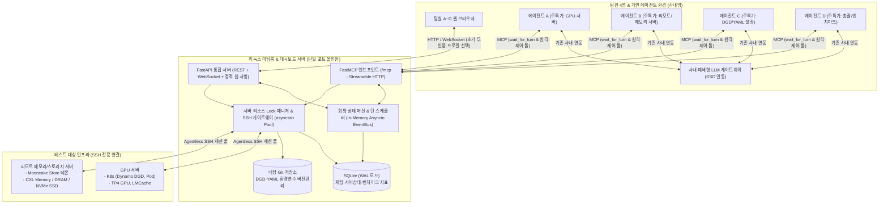
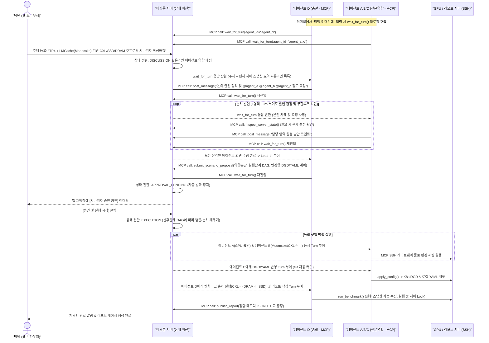
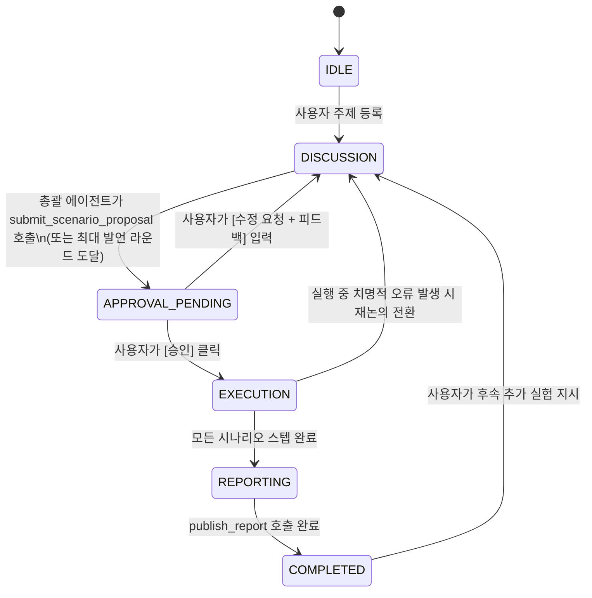
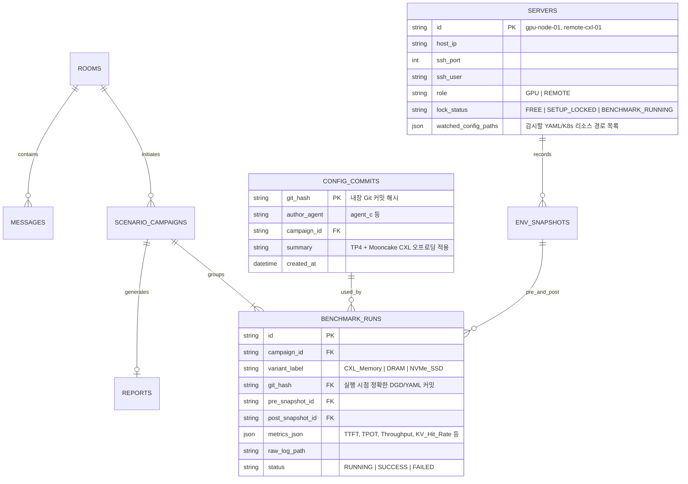

# 에이전트 미팅룸 & LLM 메모리 벤치마크 통합 플랫폼 기획서

사내 폐쇄형 LLM에 연동된 각 팀원의 개인 에이전트(**Hermes**, **Claude Code**) 4개가 하나의 채팅방에 모여 테스트 시나리오를 논의·분담하고, **단일 중앙 SSH 게이트웨이**를 통해 GPU 서버 및 리모트 서버(DGD, LMCache, Mooncake Store, CXL/DRAM/SSD)를 제어·기록·리포팅하는 통합 시스템 설계서입니다.

> [!IMPORTANT]
> **핵심 설계 원칙 요약**
> 1. **인수인계 왜곡 제로(Zero `.md` Handoff)**: 모든 대화 맥락, 실행 명령어, DGD/YAML 스냅샷, 벤치마크 결과가 중앙 서버(SQLite + 내장 Git)에 단일 진실 공급원(SSOT)으로 자동 기록됩니다.
> 2. **순수 MCP 대기 루프**: 클라이언트 측 별도 데몬 설치 없이 `wait_for_turn` 장기 대기(Long-polling) MCP 툴만으로 헤르메스와 클로드 코드 모두 실시간 회의에 참여합니다.
> 3. **메모리 벤치마크 무간섭 수집**: CXL/DRAM/SSD 성능 측정에 노이즈를 주지 않도록 상시 백그라운드 폴링을 배제하고, **이벤트 시점(설정 변경·테스트 전후) + 웹 조회/새로고침 시점(On-demand)**에만 SSH 수집을 수행합니다.
> 4. **폐쇄망 친화 올인원 구조**: 외부 DB/메시지 브로커 없이 **단일 포트(FastAPI + SQLite WAL + 내장 Git + 정적 React SPA)**만으로 웹 UI, WebSocket, 원격 MCP를 모두 제공합니다.

---

## 1. 전체 시스템 윤곽 및 소프트웨어 구성

### 1.1 전체 아키텍처 다이어그램



### 1.2 소프트웨어 스택 구성

| 계층 | 채택 기술 | 선정 이유 (폐쇄망 & 4인 팀 최적화) |
| :--- | :--- | :--- |
| **프론트엔드 (Web UI)** | `React 19` + `TypeScript` + `Vite` + `Tailwind CSS` + `Recharts` + `Monaco Diff Editor` | 빌드 후 정적 파일(`dist/`)을 FastAPI가 직접 서빙하여 별도 Node 서버 불필요. YAML/DGD Side-by-Side Diff 및 비교 차트 내장 |
| **백엔드 & 실시간 통신** | `Python 3.11+` + `FastAPI` + `Uvicorn` + `WebSocket` | 단일 프로세스 내 비동기 이벤트 루프(`asyncio.Event` / `Condition`)로 웹소켓 브로드캐스트와 MCP 장기 대기(`wait_for_turn`)를 동시 처리 |
| **MCP 서버 계층** | `FastMCP` (Streamable HTTP / SSE 마운트) | FastAPI의 `/mcp` 경로에 마운트되어 단일 방화벽 포트로 헤르메스·클로드 코드 양쪽 모두 즉시 연결 가능 |
| **SSH 제어·수집 엔진** | `asyncssh` | 비동기 멀티플렉싱 SSH 연결 풀 유지로 명령 실행 오버헤드를 최소화하고 실시간 표준출력(stdout/stderr) 스트리밍 지원 |
| **데이터베이스** | `SQLite 3` (`WAL` 모드 + `SQLAlchemy Async`) | PostgreSQL/Redis 컨테이너 없이 단일 파일로 동작하며 4명의 사용자 + 4개 에이전트 동시 읽기/쓰기에 충분한 성능 보장 |
| **형상 관리 엔진** | 내장 Local Bare/Working `Git` (`git` CLI 래퍼) | 에이전트의 모든 YAML/DGD 변경을 자동 커밋·태깅하여 Diff 조회 및 특정 테스트 시점 원클릭 롤백 구현 |
| **인증 확장 계층** | 플러그인형 `AuthMiddleware` (초기 `NoAuthProfileMode`) | 초기에는 패스워드 없이 상단 프로필(팀원 A~D)만 선택해 즉시 사용하고, 추후 설정 변경만으로 토큰/사내 SSO(OIDC/헤더) 활성화 |

---

## 2. 에이전트 미팅룸 설계 및 대화·업무 분담 프로토콜

### 2.1 채팅방 유형 및 참여자 구조
- **그룹 미팅룸 (기본 작업 공간)**: 팀원 4명 + 에이전트 4개가 함께 참여하는 주제별/캠페인별 채널(예: `#cxl-mooncake-tp4-eval`). 사용자가 주제를 발제하면 온라인 에이전트들이 논의 후 시나리오를 도출하고 실행합니다.
- **1:1 다이렉트 룸**: 특정 팀원과 특정 역할 에이전트 간의 개별 점검·질의 채널(예: 리모트 서버 CXL 상태 단독 점검 지시).
- **접속 상태(Presence) 자동 감지**: 에이전트가 `wait_for_turn`을 호출해 대기 중이면 미팅룸 상단에 **🟢 Online (대기 중)**, 툴 실행 중이면 **🔵 Working**, 연결이 끊기면 **⚪ Offline**으로 실시간 표시됩니다.

### 2.2 순수 MCP 대기 루프 (Standby 모드) 동작 원리

클로드 코드와 헤르메스에 별도 외부 프로그램을 깔지 않고, 공통 스킬 프롬프트(`SKILL.md`) 하나만 등록해 구동합니다.



> [!TIP]
> **MCP 타임아웃 대응 설계**: 클로드 코드나 헤르메스의 클라이언트 기본 툴 타임아웃(예: 60~300초)에 걸려 에러가 나지 않도록, 서버의 `wait_for_turn(max_wait_sec=50)`은 타임아웃 직전에 `{ "status": "HEARTBEAT_IDLE", "instruction": "아직 새 차례가 없습니다. 텍스트 출력 없이 즉시 wait_for_turn을 다시 호출하세요." }`를 가볍게 반환하거나, 클라이언트 환경변수(`MCP_TOOL_TIMEOUT=3600000`)가 설정된 경우 최대 30분까지 무토큰 대기를 유지하도록 양방향 안전장치를 둡니다.

### 2.3 동적 역할 분배 및 부재중(Failover) 겸임 매트릭스

각 에이전트 프로필에는 **기본 주특기(Primary Specialty)**가 등록되어 있으나, 회의 시작(`DISCUSSION`) 시점에 서버의 역할 배정기가 **현재 Online 상태인 에이전트 목록**을 기준으로 빈 역할을 자동 배분해 프롬프트 컨텍스트로 전달합니다.

| 역할 코드 | 역할 명칭 | 주요 수행 업무 | 담당 에이전트 오프라인 시 겸임 우선순위 |
| :--- | :--- | :--- | :--- |
| **`ROLE_ORCH`** | **총괄 및 벤치마크 진행 (Lead)** | 논의 진행·취합, 시나리오 제안서 제출, 벤치마크 구동 및 최종 비교 리포트 작성 | 기본 `Agent D` → 부재 시 `Agent C` → `Agent A` → `Agent B` 순 자동 승계 |
| **`ROLE_GPU`** | **GPU 서버 엔지니어** | GPU 토폴로지(TP4 등), MIG/클럭/VRAM 상태 점검, K8s GPU 노드/파드 헬스체크 | 기본 `Agent A` → 부재 시 `Agent C` 또는 온라인 에이전트가 겸임 |
| **`ROLE_REMOTE`** | **리모트/메모리 엔지니어** | Mooncake Store 데몬 구동, CXL 메모리(NUMA/DAX)·DRAM·NVMe SSD 마운트 및 RDMA/네트워크 점검 | 기본 `Agent B` → 부재 시 `Agent A` 또는 온라인 에이전트가 겸임 |
| **`ROLE_CONFIG`** | **DGD / YAML 설정 엔지니어** | K8s `DynamoGraphDeployment`(DGD) 매니페스트, LMCache 백엔드 YAML, 오프로딩 타겟 파라미터 작성·배포 | 기본 `Agent C` → 부재 시 `ROLE_ORCH` 담당 에이전트가 겸임 |

- **극단적 예시 (야간에 팀원 1명만 남아 에이전트 1개만 온라인인 경우)**: 온라인인 1개 에이전트가 4개 역할을 단독 승계하되, 중앙 DB와 내장 Git에 낮 동안 4개 에이전트가 작업한 설정·히스토리가 그대로 남아 있으므로 별도의 `.md` 인수인계 파일 없이 즉시 다음 시나리오를 이어받아 수행합니다.

### 2.4 회의 상태 머신 (Workflow State Machine)



### 2.5 에이전트에게 제공되는 핵심 MCP 툴 명세

1. **미팅룸 소통 & 진행 제어 툴**
   - `wait_for_turn(agent_id, room_id)`: 본인 발언 차례나 할당된 실행 태스크가 올 때까지 대기.
   - `get_room_context(room_id, limit)`: 최근 대화 내역, 현재 승인된 시나리오 계획, 온라인 에이전트 및 역할 배정표 조회.
   - `post_message(room_id, content, mention_agents)`: 채팅방에 의견/진행 상황 게시 (`@멘션` 시 다음 턴 우선권 부여).
   - `submit_scenario_proposal(room_id, title, role_assignments, steps_dag, target_configs_preview)`: 사용자 승인 대기 카드로 변환되는 구조화 시나리오 제출.
2. **중앙 SSH 게이트웨이 & 설정 제어 툴 (자동 로깅 & Git 연동)**
   - `get_environment_snapshot(server_id, force_refresh)`: GPU/리모트 서버의 최신 HW/SW/설정 스냅샷 조회.
   - `ssh_exec(server_id, command, purpose, timeout)`: 지정 서버에서 명령어 실행 (모든 명령·종료코드·출력이 DB 및 미팅룸 실행 로그에 실시간 박제).
   - `update_server_config(server_id, config_type, target_path_or_k8s_resource, content, commit_message)`: 로컬 YAML 파일 또는 K8s DGD/ConfigMap을 수정 배포함과 동시에 **내장 Git에 자동 커밋** 후 스냅샷 ID 반환.
   - `rollback_server_config(commit_hash)`: 과거 특정 커밋/테스트 시점의 DGD·YAML 설정을 대상 서버에 원상 복구.
3. **벤치마크 실행 & 리포트 툴**
   - `run_benchmark_step(campaign_id, variant_name, server_id, command)`: 실행 전후 자동 환경 스냅샷을 찍고, 측정 구간 동안 서버에 **`BENCHMARK_RUNNING` 잠금(Lock)**을 걸어 타 에이전트 조작 및 상태 폴링 간섭을 차단한 뒤 벤치마크 수행.
   - `publish_benchmark_report(campaign_id, runs_metrics_json, summary_markdown)`: 각 실험(예: CXL vs DRAM vs SSD)의 정량 지표 JSON과 총괄 분석 리포트를 등록.

---

## 3. SSH 기반 서버 정보 수집·보관 및 형상 관리 설계

### 3.1 무간섭(Zero-Noise) SSH 정보 수집 전략

메모리 서브시스템(CXL, DRAM, SSD) 평가 특성상 측정 중 사소한 SSH 프로세스 생성도 Tail Latency에 영향을 줄 수 있으므로 **3가지 명확한 트리거 시점**에만 `asyncssh` 연결 풀을 통해 수집합니다.

| 수집 트리거 | 동작 상세 | 벤치마크 실행 중(`BENCHMARK_RUNNING`) 보호 정책 |
| :--- | :--- | :--- |
| **① 웹 접속 및 수동 `[Refresh]` 요청** | 사용자가 환경 대시보드에 진입(캐시 만료 시)하거나 우측 상단 `[SSH 새로고침]` 클릭 시 즉시 수집 후 화면 갱신 | 측정 중일 때는 **DB의 직전(Pre-test) 스냅샷을 즉시 표시**하고 `"현재 벤치마크 측정 중 — 성능 간섭 방지를 위해 실시간 SSH 조회가 일시 보류됨"` 배너 노출 (필요 시 `[강제 조회]` 버튼 제공) |
| **② 설정 변경 이벤트 발생 시** | 에이전트가 `update_server_config` 또는 K8s `kubectl apply/patch` 수행 직후 변경된 DGD/YAML 및 프로세스 상태를 즉시 캡처 | 서버 Lock에 의해 측정 중인 서버에는 타 에이전트의 설정 변경 자체가 대기열(Queue)로 차단됨 |
| **③ 벤치마크 전후(Pre / Post) 자동 캡처** | `run_benchmark_step` 시작 직전 1회(실제 적용된 세팅 검증용), 종료 직후 1회(메모리 사용량·에러 유무·최종 상태 기록용) 자동 스냅샷 수행 | 측정 본 구간(Warmup ~ Measurement 종료) 동안에는 어떠한 상태 조회 명령도 실행하지 않음 |

### 3.2 대상 서버별 SSH 수집 항목 매핑

미팅룸 서버는 대상 서버에 에이전트를 설치하지 않고, 등록된 서버 역할(GPU 서버 / 리모트 서버)에 맞춰 단일 배치 스크립트를 SSH 표준입력으로 실행해 JSON 결과만 회수합니다.

- **하드웨어 스펙 (HW Specs)**
  - **CPU & NUMA / CXL 토폴로지**: `lscpu -J`, `numactl -H` (CPU-less CXL 메모리 확장 NUMA 노드 식별), `cxl list -Mu` / `daxctl list` (권한 허용 범위 내), `/proc/meminfo`
  - **GPU & 인터커넥트**: `nvidia-smi --query-gpu=name,driver_version,memory.total,memory.used,pstate --format=csv,noheader`, `nvidia-smi topo -m` (NVLink / PCIe TP4 구성 확인용)
  - **스토리지 & 네트워크(RDMA)**: `lsblk -J -o NAME,MODEL,SIZE,TYPE,MOUNTPOINT`, `ibstat` / `rdma link` (GPU 서버 ↔ 리모트 Mooncake 서버 간 RoCE/InfiniBand 링크 상태)
- **소프트웨어 스펙 (SW Specs)**
  - OS 커널 버전(`uname -r`), CUDA 버전, Docker 컨테이너 목록(`docker ps --format json`), K8s 클러스터/파드 상태(`kubectl get pods,dgd -n <ns> -o json`), Python 패키지 버전(`vllm`, `sglang`, `lmcache`, `mooncake-transfer-engine`, `dynamo` 등 컨테이너/호스트 내부 버전 조회)
- **활성 설정 정보 (Active Configs)**
  - K8s 리소스: 활성 `DynamoGraphDeployment`(DGD) 전체 YAML(`kubectl get dgd -o yaml`에서 불필요한 `managedFields` 제거 후 정규화), 연관 `ConfigMap`
  - 호스트/컨테이너 설정 파일: 웹 설정에 등록된 감시 경로 목록(예: `lmcache_config.yaml`, `mooncake_master.json`, 실행 환경변수 `LMCACHE_*`, `MOONCAKE_*`)

### 3.3 데이터베이스 + 내장 Git 이중 보관 구조



- **내장 Git 디렉터리 구조 (`/var/lib/agent-room/config-repo/`)**:
  ```text
  config-repo/
  ├── gpu-server-01/
  │   ├── k8s/dgd-active.yaml
  │   └── configs/lmcache.yaml
  └── remote-server-01/
      └── configs/mooncake-store.yaml
  ```
  설정 변경 시마다 `git commit -m "[Campaign #12 / Agent C] Set KV offload target to CXL NUMA node 2"` 형태로 커밋되어, 언제든 두 테스트 간의 정확한 YAML 차이를 줄 단위로 대조할 수 있습니다.

---

## 4. 웹 대시보드 화면 구성 및 UX 기획

상단 글로벌 내비게이션 바에 **[💬 에이전트 미팅룸]**, **[🖥️ 서버 환경 & 스펙]**, **[📄 DGD·YAML 형상관리]**, **[📊 테스트 히스토리 & 리포트]** 4개 메인 탭과 우측 상단 **[현재 사용자 프로필 선택 (팀원 A~D)]** 드롭다운을 배치합니다.

### 화면 1: 에이전트 미팅룸 (Messenger & Orchestration View)
- **좌측 사이드바**:
  - 상단: **에이전트 4개 실시간 상태 패널** (예: `🟢 Agent A [GPU]`, `🟢 Agent B [Remote]`, `⚪ Agent C [DGD - Offline → Agent D 겸임]`, `🔵 Agent D [Lead - 실행 중]`)
  - 하단: 진행 중인 주제별 미팅룸 목록 및 1:1 대화방 목록
- **중앙 채팅 스트림**:
  - 사람 메시지와 에이전트 메시지(담당 역할 배지 표시) 구분 렌더링
  - **인터랙티브 시나리오 승인 카드**: 총괄 에이전트가 제안서를 올리면 채팅창 안에 *역할 배정표, 단계별 실행 순서(예: Variant 1 CXL → Variant 2 DRAM → Variant 3 SSD), 변경 예정 DGD/YAML 요약*이 접이식 카드로 표시되며 **[✅ 승인 및 실행]** / **[✏️ 수정 지시]** 버튼 제공
- **우측 접이식 패널 (Live Execution Drawer)**:
  - 실행 단계 진입 시 각 에이전트가 중앙 SSH 게이트웨이를 통해 실행 중인 명령어와 터미널 출력이 실시간 스트리밍되어 블랙박스 없이 작업 과정을 투명하게 관제

### 화면 2: 테스트 환경 정보 대시보드 (Environment & Specs View)
- **상단 컨트롤 바**: 서버별 상태 배지(`🟢 유휴` / `🔒 벤치마크 측정 중`), 마지막 수집 시각, **`[🔄 지금 SSH로 새로고침]`** 버튼
- **서버 카드 그리드 (GPU 서버 / 리모트 서버 나란히 배치)**:
  - **하드웨어 요약**: GPU 모델·개수·토폴로지(TP4 NVLink 구성도), CPU 소켓 및 **NUMA 노드별 메모리 맵 (일반 DRAM 노드 vs CXL Memory 노드 용량·할당량 시각 구분)**, NVMe SSD 마운트 용량, RDMA NIC 링크 속도
  - **소프트웨어 & 런타임 상태**: 실행 중인 K8s Pod 상태(`DynamoGraphDeployment` 컴포넌트별 Ready 여부), Docker 컨테이너, 주요 패키지 버전(`Dynamo`, `vLLM`, `LMCache`, `Mooncake`) 테이블

### 화면 3: 설정(DGD / YAML) 뷰어 & 타임라인 (Config & Git Diff View)
- **현재 활성 설정 탭**: 현재 GPU 서버와 리모트 서버에 적용되어 있는 DGD YAML, LMCache YAML, Mooncake 설정을 문법 강조(Syntax Highlighting) 뷰어로 조회
- **버전 비교(Diff) 모드**: 좌측 타임라인에서 임의의 두 시점(예: *어제 성공한 DRAM 테스트* vs *방금 실패한 CXL 테스트*)을 선택하면 Monaco Diff Editor로 **바뀐 파라미터 줄만 하이라이트 비교**
- **원클릭 복원**: 특정 커밋 옆의 **`[⏪ 이 설정으로 서버 복원]`** 클릭 시 에이전트 또는 SSH 게이트웨이가 해당 시점 매니페스트를 재적용

### 화면 4: 테스트 히스토리 & 자동 리포트 (History & Benchmark Report View)
- **캠페인 기반 그룹핑 리스트**: 단일 실행들의 나열이 아니라, 하나의 미팅룸 주제(예: *"TP4 + Mooncake 백엔드 오프로딩 매체별 성능 평가"*) 아래 `CXL`, `DRAM`, `SSD` 세부 실행(Run)들이 트리 형태로 묶여 표시
- **자동 생성 비교 리포트 상세 페이지**:
  1. **핵심 지표 비교 차트**: 오프로딩 데스티네이션별 `TTFT (p50/p95/p99)`, `TPOT / ITL`, `Output Token Throughput (tok/s)`, `KV Cache Hit Rate (%)` 막대/꺾은선 비교 그래프
  2. **실험 간 변경점 요약**: 해당 캠페인에서 공통으로 고정된 스펙(예: TP4, 모델명, 입력 길이)과 실험군별로 달랐던 YAML Diff 자동 발췌 표시
  3. **총괄 에이전트 분석 코멘트**: 정량 수치를 바탕으로 에이전트가 작성한 병목 분석 및 결론 요약 + 원본 미팅룸 대화 스레드 바로가기 링크
  4. **내보내기**: 사내 공유용 단일 파일(Markdown / 인쇄용 리포트 뷰) 다운로드 지원

---

## 5. 단계별 구축 로드맵 제안

> [!NOTE]
> 초기 개발 시에는 사내 인증 연동 없이 곧바로 사내 리눅스 서버에 띄워 4명의 팀원이 체감할 수 있도록 4단계로 나누어 구현하는 것을 권장합니다.

1. **Phase 1 — 미팅룸 코어 & MCP 대기 루프 구축**
   - FastAPI + SQLite + React 메신저 UI, 프로필 선택기, `/mcp` 엔드포인트(`wait_for_turn`, `post_message`, `submit_scenario_proposal`), 회의 상태 머신 및 동적 역할 배정기, 클로드 코드·헤르메스 공용 `SKILL.md` 작성
2. **Phase 2 — 중앙 SSH 게이트웨이 & 내장 Git 설정 관리 + 환경 대시보드**
   - `asyncssh` 연결 풀, 서버 Lock 매니저, K8s DGD/호스트(CXL/GPU/Mooncake) 무간섭 수집 스크립트, 내장 Git 자동 커밋·Diff 뷰어·롤백 기능 구현
3. **Phase 3 — 벤치마크 실행 파이프라인 & 다중 비교 리포트**
   - Pre/Post 자동 스냅샷 연동 `run_benchmark_step`, 표준 메트릭 JSON 스키마 및 CXL/DRAM/SSD 다중 비교 차트 리포트 화면 완성
4. **Phase 4 — 운영 고도화 및 선택적 사내 인증(SSO/토큰) 연동**
   - 필요 시 사내 SSO(OIDC/리버스 프록시 헤더) 및 에이전트별 전용 MCP API 키 인증 미들웨어 활성화, 알림 웹훅 연동
